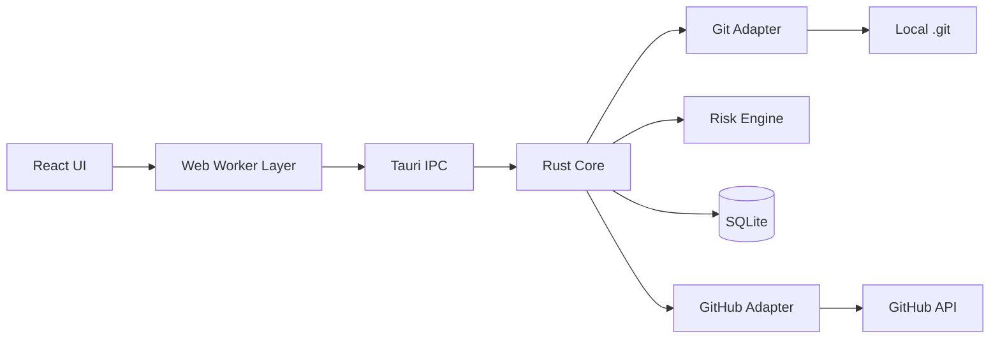
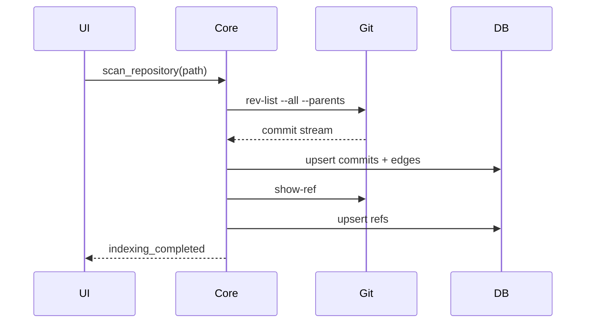
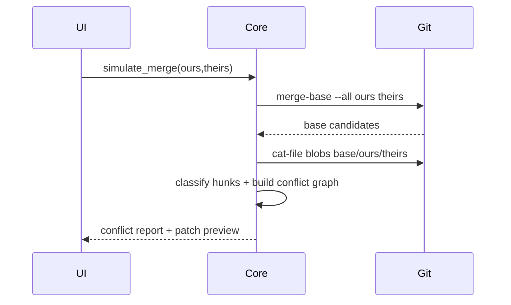
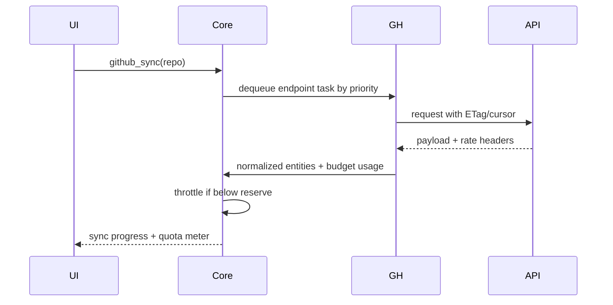
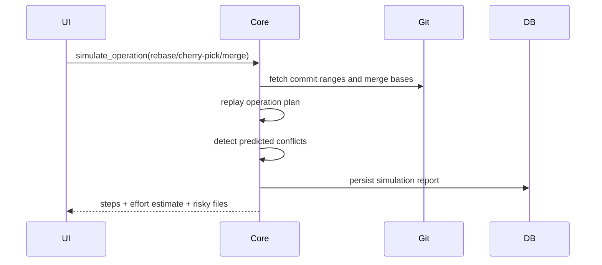
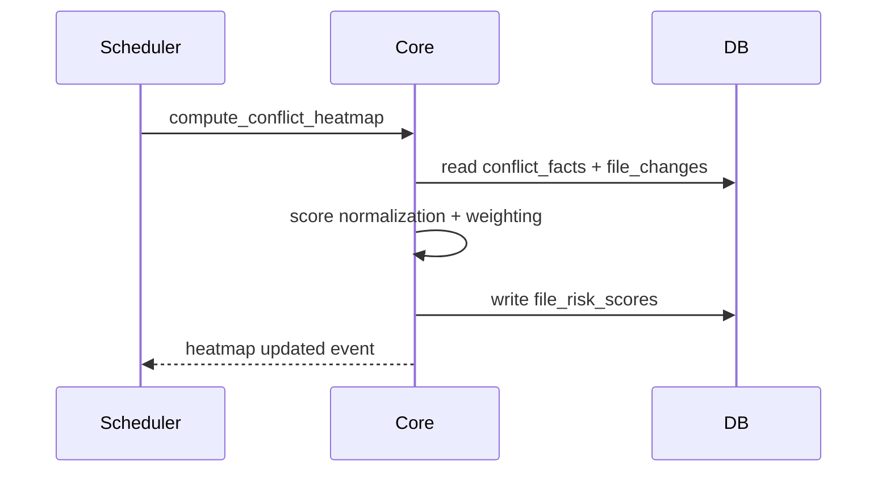

# GitGraph Lab - Software Design Document (SDD)

Version: 2.0  
Date: 2026-03-06  
Author: Deependra Rathod

---

## 1. Executive Summary

GitGraph Lab is a desktop-first Git engineering laboratory that combines:

1. Git commit DAG visualizer with graph algorithms
2. Merge conflict simulator with 3-way merge internals
3. Diff algorithm playground (LCS + Myers)
4. Git internals explorer (objects, trees, packs, deltas)
5. GitHub sync with strict rate-limit budgeting
6. "Astonish layer" features:
   - What-If Engine (simulate merge/rebase/cherry-pick before running)
   - Conflict Heatmap (predict merge pain zones)
   - Blast Radius Analyzer (change impact tracing)
   - Git Forensics Timeline (lineage and regressions)
   - PR Risk Radar (explainable merge/review risk score)

This document is performance-first and 8 GB RAM friendly. It defines a practical, production-grade architecture for a final-year project that demonstrates strong CS fundamentals and real developer value.

---

## 2. Problem Statement

Most Git tools optimize for routine workflows but hide how Git actually behaves:

1. DAG traversal and ancestry reasoning are opaque.
2. Merge conflicts appear as plain text markers without explanation.
3. Diff algorithm behavior is not inspectable.
4. Packfile and delta internals are inaccessible.
5. GitHub sync can break under naive rate-limit handling.
6. Teams cannot estimate merge risk before integration.

GitGraph Lab solves this with algorithm-first visual workflows and deterministic "what-if" simulation.

---

## 3. Product Goals and Non-Goals

### 3.1 Goals

1. Visualize commit graph and branch lanes at 10k to 150k commits.
2. Simulate merge/rebase/cherry-pick and explain conflicts before execution.
3. Teach LCS and Myers through trace-level UI.
4. Expose object storage path from commit to packed blob.
5. Provide risk intelligence:
   - conflict heatmap
   - blast radius
   - PR risk score
6. Sync GitHub metadata reliably within explicit API budgets.
7. Run smoothly on 8 GB RAM laptops.

### 3.2 Non-Goals (v1)

1. Full Git CLI replacement.
2. Real-time collaborative editing.
3. Training ML models in-app.
4. Cloud-hosted multi-tenant backend.

---

## 4. Users and Key Use Cases

### 4.1 User Personas

1. CS Student: learns graph, diff, and merge algorithms on real repos.
2. Team Lead: identifies risky merges and integration hotspots.
3. Open-source Maintainer: reviews PR risk and historical lineage quickly.

### 4.2 Core Use Cases

1. "Show shortest ancestry path between commit A and B."
2. "Simulate rebase branch X onto main and show exact conflict hunks."
3. "Compare LCS vs Myers on this file and explain why outputs differ."
4. "Trace this blob from commit tree to pack entry."
5. "Which files are conflict hotspots this sprint?"
6. "What is the blast radius of this commit?"
7. "Is this PR risky, and why?"

---

## 5. Scope Breakdown

### 5.1 MVP Scope (mandatory, 8 weeks)

1. Local repo indexing and DAG rendering
2. DFS/BFS/topological path tools
3. Merge simulator (merge only)
4. Diff playground (LCS + Myers)
5. Object/tree explorer + pack summary via plumbing
6. GitHub repo + PR sync with quota dashboard

### 5.2 Astonish Scope (v1.5, +2 weeks)

1. What-If Engine for rebase/cherry-pick simulation
2. Conflict Heatmap with transparent scoring formula
3. Blast Radius Analyzer with dependency-aware impact graph
4. Git Forensics Timeline for line and commit lineage
5. PR Risk Radar with explainable factors

### 5.3 Stretch Scope (v2)

1. Native packfile parser and delta replay animation
2. Multi-repo workspace
3. Cross-repo dependency impact

---

## 6. Architecture Overview

### 6.1 Performance-First Technology Stack

1. Desktop shell: Tauri v2
2. UI: React + TypeScript + Vite
3. State and data:
   - Zustand for local UI state
   - TanStack Query for async cache
4. Rendering:
   - Sigma.js (WebGL) for large DAG
   - Cytoscape.js for focused subgraph analysis
5. Worker offload: Web Workers + Comlink for heavy layout/math in UI
6. Core engine: Rust
   - `tokio` for async I/O
   - `rayon` for parallel CPU jobs
   - `petgraph` for graph algorithms
7. Git adapter:
   - Phase 1: `git` plumbing commands (safe argument arrays)
   - Phase 2: `libgit2` on hot paths
8. Local data:
   - SQLite with WAL, tuned pragmas, batched writes
9. Secrets:
   - OS keychain (PAT token only)
10. APIs:
   - GitHub REST + GraphQL with budget scheduler

### 6.2 High-Level Component Diagram



### 6.3 Architectural Style

1. Local-first desktop architecture
2. Hexagonal core: domain engine separated from adapters
3. Job-based execution with priorities:
   - `interactive`
   - `background`
   - `maintenance`
4. Event-driven UI updates from engine
5. Read-optimized indexes for graph and risk queries

### 6.4 Performance Architecture

1. Streaming index pipeline:
   - parse commit stream incrementally
   - avoid loading full history in memory
2. Adjacency compaction:
   - map SHA -> int node IDs
   - store edges as compact integer vectors
3. Batch Git operations:
   - `cat-file --batch`
   - grouped ref and object queries
4. SQLite tuning profile:
   - `journal_mode=WAL`
   - `synchronous=NORMAL`
   - `temp_store=MEMORY`
   - `mmap_size` and `cache_size` tuned by RAM class
5. View virtualization:
   - only render visible graph window
   - progressive detail on zoom
6. Resource guardrails:
   - memory soft cap + spill-to-disk policies
   - kill-switch for expensive operations

---

## 7. Detailed Module Design

## 7.1 Commit DAG Visualizer

### 7.1.1 Input Sources

1. `git rev-list --all --parents --topo-order --date-order`
2. `git show-ref --heads --tags --dereference`
3. `git cat-file --batch-check` for object metadata

### 7.1.2 Domain Model

1. `CommitNode`: sha, parents[], tree_sha, times, author, subject
2. `RefPointer`: ref_name, target_sha, type
3. `LaneState`: lane_id, color_key, merge_crossings

### 7.1.3 Algorithms

1. DFS for depth traversal and ancestry trace
2. BFS for minimum-edge path in unweighted graph
3. Bidirectional BFS for commit-to-commit shortest path
4. Kahn-style topological ordering for deterministic display
5. Lane assignment with active-lane heap

Complexity targets:

1. Graph build: O(V + E)
2. Query traversal: O(V + E) worst-case
3. Lane assignment: O(V log B), B active lanes

### 7.1.4 Rendering Strategy

1. Precompute lanes in Rust
2. WebGL rendering for high node density
3. Chunked commit window API (`cursor`, `limit`)
4. Dynamic level-of-detail:
   - dense mode for zoomed-out
   - full commit cards on zoom-in

### 7.1.5 UX Capabilities

1. Commit details panel with file stats and refs
2. Trace root or merge-base path
3. Path highlight between selected commits
4. Filter by author/date/ref/path regex

---

## 7.2 Merge Conflict Simulator

### 7.2.1 Input

1. `ours` and `theirs` commit SHA
2. Optional strategy flags (`ignore-space-change`, EOL policy)
3. Mode:
   - `educational` (no silent auto-fix)
   - `practical` (show candidate quick-fixes)

### 7.2.2 Base Selection

1. Compute base set with `git merge-base --all`
2. Consolidate multiple bases recursively (Git-like)
3. Persist:
   - selected base
   - alternate bases
   - selection reason

### 7.2.3 3-Way Merge Model

Per path touched in either side:

1. Load blobs (base/ours/theirs)
2. Compute alignment and hunk overlap
3. Classify hunks:
   - clean-ours
   - clean-theirs
   - identical-edits
   - true-conflict
4. Build `ConflictGraph`:
   - node: conflict hunk
   - edge: overlapping or adjacent conflict segments

### 7.2.4 Conflict Visual UX

1. Triple-pane base/ours/theirs
2. Conflict list sorted by severity and file churn
3. Resolution actions:
   - choose ours
   - choose theirs
   - combine
   - manual
4. Export merged preview as patch

### 7.2.5 Correctness Rules

1. No silent conflict auto-resolution in educational mode
2. Binary file conflicts explicitly flagged unsupported
3. Whitespace/EOL normalization shown as toggles, never hidden

---

## 7.3 Diff Algorithm Playground

### 7.3.1 Supported Algorithms

1. LCS dynamic programming (teaching mode)
2. Myers O(ND) shortest edit script (production mode)

### 7.3.2 Mode Selection

1. <= 3k lines: LCS matrix and Myers trace both available
2. > 3k lines: Myers default, LCS summary only

### 7.3.3 Visual Outputs

1. Edit script timeline (keep/insert/delete)
2. LCS matrix path animation
3. Myers frontier growth by D layer
4. Unified patch parity check with `git diff`

### 7.3.4 Validation

1. Golden corpus parity vs Git outputs
2. Property tests: applying script transforms A -> B exactly

---

## 7.4 Git Internals Explorer

### 7.4.1 Object Layer

Commands:

1. `git cat-file -t/-s/-p <obj>`
2. `git ls-tree -r <treeish>`
3. `git rev-parse <rev>`
4. `git hash-object -w` (sandboxed demo mode only)

Views:

1. Object browser (blob/tree/commit/tag)
2. Tree entry mode/path/oid explanation
3. Commit metadata and parent chain

### 7.4.2 Pack Layer

v1 (plumbing-backed):

1. `git verify-pack -v`
2. `git count-objects -vH`

v2 (native parser):

1. PACK header decode
2. Per-object type/size varint decode
3. Inflate zlib payloads
4. OFS_DELTA and REF_DELTA chain resolution

### 7.4.3 Educational Views

1. Commit -> tree -> blob -> pack trace
2. Delta-chain depth heatmap
3. Compression hotspot table

---

## 7.5 GitHub Integration

### 7.5.1 Auth Modes

1. Fine-grained PAT (default)
2. Classic PAT (fallback)
3. OAuth device flow (optional later)

### 7.5.2 Sync Targets

1. Repository metadata
2. Branches and branch protection summary
3. Pull requests and timeline subset
4. PR-linked commits and file stats

### 7.5.3 Sync Strategy

1. Incremental sync by cursor/checkpoint
2. ETag conditional requests where supported
3. Queue classes:
   - priority: user-triggered
   - normal: visible-page refresh
   - low: background hydration
4. Retry model:
   - exponential backoff + jitter
   - separate handling for secondary limits

### 7.5.4 Rate Limit Manager

Tracked:

1. `x-ratelimit-limit`
2. `x-ratelimit-remaining`
3. `x-ratelimit-used`
4. `x-ratelimit-reset`
5. `x-ratelimit-resource`
6. GraphQL query cost

Policy:

1. Reserve budget for interactive actions
2. Defer background jobs below threshold
3. Sleep until reset when exhausted
4. Show live budget telemetry in UI

---

## 7.6 What-If Engine

### 7.6.1 Purpose

Simulate Git operations before user runs them:

1. merge
2. rebase
3. cherry-pick

### 7.6.2 Execution Model

1. Create disposable simulation context
2. Compute operation plan from selected commits/branches
3. Replay operation logically using merge model
4. Produce deterministic report:
   - conflict files and hunks
   - operation steps
   - expected manual effort estimate

### 7.6.3 Output Contract

1. `SimulationRun`
2. `SimulationStep[]`
3. `PredictedConflict[]`
4. `PatchPreview[]`

### 7.6.4 Performance Notes

1. File-level diff cache shared across steps
2. Abort if simulation exceeds configured CPU/time budget

---

## 7.7 Conflict Heatmap

### 7.7.1 Purpose

Identify files and file pairs with high expected merge pain.

### 7.7.2 Feature Inputs

1. Historical merge conflicts per file
2. Recent churn and commit frequency
3. Co-change entropy (how broadly file co-evolves)
4. Author dispersion (ownership fragmentation)
5. Branch divergence depth

### 7.7.3 Score Formula (0-100)

```text
risk = 100 * (
  0.35 * conflict_rate +
  0.25 * cochange_entropy_norm +
  0.25 * recency_churn_norm +
  0.15 * ownership_dispersion
)
```

### 7.7.4 UX Output

1. Repo heatmap by directory/file
2. "Top 20 risky files" list
3. Risk trend by week
4. Explainability panel with factor contribution

---

## 7.8 Blast Radius Analyzer

### 7.8.1 Purpose

Estimate integration impact of a commit/branch/PR before merge.

### 7.8.2 Inputs

1. Changed files in target range
2. Language-aware import graph (start with JS/TS)
3. Test mapping (test files to source paths)
4. Historical failure hotspots (if available)

### 7.8.3 Outputs

1. Direct impact set (changed files)
2. Indirect impact set (dependent modules)
3. Test impact set (likely affected tests)
4. Blast radius score and ranked reasons

### 7.8.4 Score Formula (0-100)

```text
blast = 100 * (
  0.30 * direct_churn_norm +
  0.30 * dependency_reach_norm +
  0.20 * test_impact_norm +
  0.20 * hotspot_overlap_norm
)
```

---

## 7.9 Git Forensics Timeline

### 7.9.1 Purpose

Enable root-cause exploration for regressions and suspicious lines.

### 7.9.2 Inputs and Commands

1. `git blame --line-porcelain`
2. `git log --follow -- <path>`
3. `git log -L <start>,<end>:<file>`
4. Optional assisted bisect workflow

### 7.9.3 Outputs

1. Lineage timeline (who changed what and when)
2. Revert/reintroduce chain
3. Suspect commit shortlist with reasons

### 7.9.4 UX

1. Time slider with commit anchors
2. Side-by-side historical snippet playback
3. "Jump to introducing commit" shortcuts

---

## 7.10 PR Risk Radar

### 7.10.1 Purpose

Show explainable PR risk before review/merge.

### 7.10.2 Inputs

1. Files changed count
2. Added/deleted lines
3. Cross-module edit spread
4. Heatmap overlap
5. Recent conflict history
6. Review depth (comments/approvals optional)

### 7.10.3 Score Formula (0-100)

```text
pr_risk = 100 * (
  0.20 * churn_norm +
  0.20 * module_spread_norm +
  0.20 * conflict_overlap_norm +
  0.20 * hotspot_overlap_norm +
  0.20 * historical_rework_norm
)
```

### 7.10.4 Output

1. Band:
   - Low (0-34)
   - Medium (35-69)
   - High (70-100)
2. Top risk drivers with percentages
3. Recommended reviewer focus files

---

## 8. Data Design

## 8.1 SQLite Schema (proposed)

```sql
CREATE TABLE repositories (
  id INTEGER PRIMARY KEY,
  path TEXT NOT NULL UNIQUE,
  name TEXT NOT NULL,
  git_dir TEXT NOT NULL,
  default_branch TEXT,
  indexed_at TEXT
);

CREATE TABLE commits (
  sha TEXT PRIMARY KEY,
  repo_id INTEGER NOT NULL,
  author_name TEXT,
  author_email TEXT,
  author_time INTEGER,
  committer_time INTEGER,
  subject TEXT,
  body TEXT,
  tree_sha TEXT,
  FOREIGN KEY(repo_id) REFERENCES repositories(id)
);

CREATE TABLE commit_edges (
  child_sha TEXT NOT NULL,
  parent_sha TEXT NOT NULL,
  repo_id INTEGER NOT NULL,
  PRIMARY KEY(child_sha, parent_sha)
);

CREATE TABLE refs (
  repo_id INTEGER NOT NULL,
  ref_name TEXT NOT NULL,
  target_sha TEXT NOT NULL,
  ref_type TEXT NOT NULL,
  PRIMARY KEY(repo_id, ref_name)
);

CREATE TABLE file_changes (
  repo_id INTEGER NOT NULL,
  commit_sha TEXT NOT NULL,
  file_path TEXT NOT NULL,
  additions INTEGER NOT NULL,
  deletions INTEGER NOT NULL,
  change_type TEXT NOT NULL,
  PRIMARY KEY(repo_id, commit_sha, file_path)
);

CREATE TABLE simulation_runs (
  id INTEGER PRIMARY KEY,
  repo_id INTEGER NOT NULL,
  operation_type TEXT NOT NULL,
  base_ref TEXT,
  source_ref TEXT,
  target_ref TEXT,
  status TEXT NOT NULL,
  started_at TEXT NOT NULL,
  finished_at TEXT
);

CREATE TABLE simulation_conflicts (
  run_id INTEGER NOT NULL,
  file_path TEXT NOT NULL,
  hunk_index INTEGER NOT NULL,
  conflict_type TEXT NOT NULL,
  effort_score REAL,
  PRIMARY KEY(run_id, file_path, hunk_index)
);

CREATE TABLE conflict_facts (
  repo_id INTEGER NOT NULL,
  merge_commit_sha TEXT NOT NULL,
  file_path TEXT NOT NULL,
  conflict_count INTEGER NOT NULL,
  recorded_at TEXT NOT NULL,
  PRIMARY KEY(repo_id, merge_commit_sha, file_path)
);

CREATE TABLE file_risk_scores (
  repo_id INTEGER NOT NULL,
  file_path TEXT NOT NULL,
  score REAL NOT NULL,
  factors_json TEXT NOT NULL,
  computed_at TEXT NOT NULL,
  PRIMARY KEY(repo_id, file_path)
);

CREATE TABLE blast_radius_runs (
  id INTEGER PRIMARY KEY,
  repo_id INTEGER NOT NULL,
  target_sha TEXT NOT NULL,
  score REAL NOT NULL,
  summary_json TEXT NOT NULL,
  computed_at TEXT NOT NULL
);

CREATE TABLE forensics_runs (
  id INTEGER PRIMARY KEY,
  repo_id INTEGER NOT NULL,
  file_path TEXT NOT NULL,
  line_start INTEGER,
  line_end INTEGER,
  summary_json TEXT NOT NULL,
  computed_at TEXT NOT NULL
);

CREATE TABLE pr_risk_scores (
  repo_id INTEGER NOT NULL,
  pr_number INTEGER NOT NULL,
  score REAL NOT NULL,
  band TEXT NOT NULL,
  factors_json TEXT NOT NULL,
  computed_at TEXT NOT NULL,
  PRIMARY KEY(repo_id, pr_number)
);

CREATE TABLE github_sync_state (
  repo_id INTEGER PRIMARY KEY,
  etag TEXT,
  cursor TEXT,
  last_synced_at TEXT,
  rate_remaining INTEGER,
  rate_reset_epoch INTEGER
);
```

Indexes:

1. `commits(repo_id, committer_time DESC)`
2. `commit_edges(parent_sha)`
3. `refs(repo_id, target_sha)`
4. `file_changes(repo_id, file_path)`
5. `conflict_facts(repo_id, file_path)`
6. `pr_risk_scores(repo_id, score DESC)`

---

## 9. Command/API Contracts

## 9.1 Tauri Command Surface (Rust -> UI)

1. `scan_repository(path) -> RepositorySummary`
2. `index_commits(repo_id, mode) -> JobId`
3. `get_commit_window(repo_id, cursor, limit, filters) -> CommitWindow`
4. `find_path_between_commits(repo_id, from_sha, to_sha) -> CommitPath`
5. `simulate_merge(repo_id, ours_sha, theirs_sha, options) -> MergeRun`
6. `simulate_operation(repo_id, operation, source, target, options) -> SimulationRun`
7. `run_diff(repo_id, file_path, left_sha, right_sha, algorithm) -> DiffTrace`
8. `inspect_object(repo_id, object_id) -> ObjectDetail`
9. `inspect_pack(repo_id, pack_id) -> PackSummary`
10. `compute_conflict_heatmap(repo_id, window_days) -> HeatmapReport`
11. `analyze_blast_radius(repo_id, target_sha, options) -> BlastRadiusReport`
12. `build_forensics_timeline(repo_id, file_path, line_range) -> ForensicsReport`
13. `score_pr_risk(repo_id, pr_number) -> PrRiskReport`
14. `github_sync(repo_id, scope) -> SyncReport`
15. `get_rate_limit_status(repo_id) -> RateLimitState`

## 9.2 Event Stream to UI

1. `job_progress`
2. `indexing_completed`
3. `simulation_completed`
4. `conflict_heatmap_updated`
5. `blast_radius_ready`
6. `forensics_ready`
7. `pr_risk_updated`
8. `sync_rate_limited`
9. `error_notification`

---

## 10. Core Flows (Sequence)

## 10.1 Repo Indexing



## 10.2 Merge Simulation



## 10.3 GitHub Sync with Budgeting



## 10.4 What-If Operation Simulation



## 10.5 Risk Pipeline



---

## 11. Non-Functional Requirements

### 11.1 Performance

1. Initial index of 100k commits <= 120 sec on SSD.
2. Incremental index (new 500 commits) <= 5 sec.
3. Commit window query (300 visible nodes) p95 <= 100 ms.
4. Path query between two commits p95 <= 150 ms.
5. Merge simulation for <= 3 MB text change set <= 2.5 sec.
6. UI target 60 FPS with <= 2k visible nodes.
7. Startup cold <= 4 sec, warm <= 2 sec.
8. RAM usage:
   - steady-state <= 1.2 GB
   - short peak <= 2.0 GB

### 11.2 Reliability

1. Crash-safe checkpoints during indexing every N commits.
2. Idempotent re-index and safe resume.
3. GitHub sync resumes with cursor and ETag state.
4. Deterministic score recomputation for same input window.

### 11.3 Security

1. Minimal Tauri capabilities by command scope.
2. No shell-string interpolation from user input.
3. Canonical path checks prevent path escape.
4. PAT stored only in OS keychain.
5. Logs redact secrets and auth headers.

### 11.4 Portability

1. Windows primary target.
2. Linux/macOS support through command adapter abstraction.

---

## 12. Security Design

### 12.1 Threat Model

1. Malicious repository content (path tricks, giant objects).
2. Command injection via crafted refs or file names.
3. API token leakage.
4. Resource exhaustion from huge histories and pathological deltas.
5. Unsafe file rendering in UI.

### 12.2 Mitigations

1. Use argument arrays with strict validation.
2. Validate repo root and canonicalize all paths.
3. Enforce object/file size thresholds and timeouts.
4. Limit delta-chain parse depth in v2 parser.
5. Escape/sanitize rendered text and markdown.
6. Scope Tauri capabilities per window and command.
7. Redact secrets from crash reports and diagnostics export.

---

## 13. Observability and Diagnostics

1. Structured JSON logs with correlation IDs.
2. Job timeline table for every long-running task.
3. Built-in diagnostics:
   - indexing throughput (commits/sec)
   - query latency p50/p95/p99
   - DAG render FPS
   - memory and cache hit ratio
   - GitHub quota meter
4. Risk analytics diagnostics:
   - heatmap recompute duration
   - score distribution drift
   - top factor contribution per score
5. Export anonymized debug bundle for issue reports.

---

## 14. Testing Strategy

### 14.1 Unit Tests

1. Graph traversal correctness (DFS/BFS/topological)
2. Bidirectional BFS shortest path
3. Merge hunk classifier and conflict graph builder
4. LCS/Myers core routines
5. Heatmap, blast, and PR scoring formulas
6. Rate-limit scheduler decisions

### 14.2 Integration Tests

1. Golden repositories:
   - linear
   - branching
   - octopus merge
   - criss-cross merge
2. Compare merge simulation vs `git merge-tree`
3. Diff parity vs `git diff`
4. Forensics parity checks vs `git blame` and `git log -L`

### 14.3 Property/Fuzz Tests

1. Edit script round-trip properties
2. Random DAG generation preserving acyclicity
3. Malformed pack/delta fuzz tests (v2 parser)
4. Score stability under benign permutation of commit order

### 14.4 Performance and Soak Tests

1. 100k-commit indexing benchmark
2. 8-hour background sync and analytics soak
3. Memory leak tests for repeated graph interactions

### 14.5 End-to-End

1. Import repo -> graph -> what-if simulation -> heatmap -> PR risk
2. Offline and GitHub secondary-limit scenarios

---

## 15. UX and Visualization Spec

### 15.1 Main Layout

1. Left: repositories, branches, refs
2. Center: commit DAG canvas
3. Right tabs:
   - Commit
   - Merge Lab
   - Diff Lab
   - Internals
   - Heatmap
   - Blast Radius
   - Forensics
   - PR Risk
4. Bottom: jobs, diagnostics, rate-limit console

### 15.2 Visual Grammar

1. Commit nodes:
   - circle = normal commit
   - diamond = merge commit
2. Edge styles:
   - solid = parent edge
   - emphasized = selected path
3. Conflict overlays:
   - red intensity by hunk severity
4. Heatmap:
   - color by risk score band
5. Blast graph:
   - edge thickness by dependency strength

### 15.3 Accessibility

1. Keyboard-only graph navigation
2. High-contrast and color-blind-safe palettes
3. Reduced-motion mode for animations

---

## 16. Implementation Plan (10 Weeks, Performance-First)

### Week 1

1. Tauri + React + Rust scaffold
2. SQLite schema and migration pipeline
3. Repository scan and commit import foundation

### Week 2

1. DAG index and query APIs
2. WebGL graph renderer integration
3. Commit details and filters

### Week 3

1. DFS/BFS/topological + shortest-path tools
2. Query cache and memory compaction
3. Baseline performance benchmarks

### Week 4

1. Merge simulation engine
2. Conflict graph and triple-pane UI
3. Patch preview/export

### Week 5

1. Diff lab (LCS + Myers)
2. Algorithm trace visualizations
3. Parity and property tests

### Week 6

1. Object/tree explorer
2. Pack summary and compression views
3. Diagnostics panel v1

### Week 7

1. GitHub auth and sync queues
2. Rate-limit manager and telemetry
3. Resume sync logic

### Week 8

1. What-If Engine (rebase/cherry-pick simulation)
2. Simulation report UI
3. Time-budget and cache controls

### Week 9

1. Conflict Heatmap and Blast Radius Analyzer
2. Scoring formulas and explainability panel
3. Risk data persistence

### Week 10

1. Forensics Timeline + PR Risk Radar
2. Security hardening and E2E tests
3. Final demo script and release build

---

## 17. Risk Register

1. Large repos degrade graph rendering performance.
   - Mitigation: WebGL renderer, windowed data, LOD.
2. Merge simulation diverges from actual Git behavior in edge cases.
   - Mitigation: differential tests against `git merge-tree`.
3. Risk scores become noisy or untrusted.
   - Mitigation: transparent formula and factor attribution.
4. GitHub secondary limits reduce UX quality.
   - Mitigation: reserve budget and queue prioritization.
5. Pack parser complexity slips schedule.
   - Mitigation: keep parser as v2 stretch; ship plumbing-backed views first.

---

## 18. Acceptance Criteria

1. User can import and interact with a 100k-commit DAG.
2. User can compute shortest path between reachable commits.
3. User can run merge/rebase/cherry-pick what-if simulation with conflict output.
4. User can inspect LCS and Myers traces and verify patch parity.
5. User can trace commit -> tree -> blob -> pack summary.
6. User can view conflict heatmap and blast radius with explainable factors.
7. User can open forensics timeline for a file or line range.
8. User can score GitHub PR risk and inspect factor breakdown.
9. GitHub sync respects rate limits and recovers from secondary limit events.
10. App remains usable on 8 GB RAM with stated performance constraints.

---

## 19. Demo Storyline (Judge-Focused)

1. Import a non-trivial repository and render full DAG.
2. Select two commits and show shortest-path reasoning.
3. Run what-if rebase simulation and show exact predicted conflicts.
4. Open conflict heatmap and identify top risk files.
5. Pick a risky commit and run blast radius analysis.
6. Trace one suspicious line with forensics timeline.
7. Pull a PR from GitHub and show PR Risk Radar with explainable factors.
8. Show live quota meter throttling background sync without breaking UX.

---

## 20. References (Primary Sources)

Git internals and plumbing:

1. Git rev-list manual: https://git-scm.com/docs/git-rev-list
2. Git merge-base manual: https://git-scm.com/docs/git-merge-base
3. Git merge-tree manual: https://git-scm.com/docs/git-merge-tree
4. Git rebase manual: https://git-scm.com/docs/git-rebase
5. Git cherry-pick manual: https://git-scm.com/docs/git-cherry-pick
6. Git cat-file manual: https://git-scm.com/docs/git-cat-file
7. Git ls-tree manual: https://git-scm.com/docs/git-ls-tree
8. Git blame manual: https://git-scm.com/docs/git-blame
9. Git commit-graph manual: https://git-scm.com/docs/git-commit-graph
10. Git pack format docs: https://git-scm.com/docs/pack-format
11. Git verify-pack manual: https://git-scm.com/docs/git-verify-pack
12. Git count-objects manual: https://git-scm.com/docs/git-count-objects
13. Git book (objects): https://git-scm.com/book/en/v2/Git-Internals-Git-Objects
14. Git book (packfiles): https://git-scm.com/book/en/v2/Git-Internals-Packfiles

GitHub API and limits:

15. REST rate limits: https://docs.github.com/en/rest/using-the-rest-api/rate-limits-for-the-rest-api
16. GraphQL rate/query limits: https://docs.github.com/en/graphql/overview/rate-limits-and-query-limits-for-the-graphql-api
17. Secondary rate limits: https://docs.github.com/en/rest/using-the-rest-api/best-practices-for-using-the-rest-api#dealing-with-secondary-rate-limits
18. Conditional requests: https://docs.github.com/en/rest/using-the-rest-api/best-practices-for-using-the-rest-api#use-conditional-requests-if-appropriate
19. REST pagination: https://docs.github.com/en/rest/using-the-rest-api/using-pagination-in-the-rest-api

Desktop/runtime and data:

20. Tauri capabilities (v2): https://v2.tauri.app/security/capabilities/
21. Tauri calling Rust commands: https://v2.tauri.app/develop/calling-rust/
22. SQLite WAL: https://sqlite.org/wal.html
23. SQLite pragmas: https://sqlite.org/pragma.html

Algorithms:

24. Myers, "An O(ND) Difference Algorithm and Its Variations" (1986): https://doi.org/10.1007/BF01840446

---

## 21. Optional Next Documents

1. Detailed API spec (`/docs/api-contract.md`)
2. UI wireframe package (`/docs/ui-spec.md`)
3. Test plan matrix (`/docs/test-plan.md`)
4. Threat model report (`/docs/security-threat-model.md`)
5. Scoring formulas and calibration notes (`/docs/risk-model-spec.md`)
6. Performance tuning profile (`/docs/performance-profile.md`)

